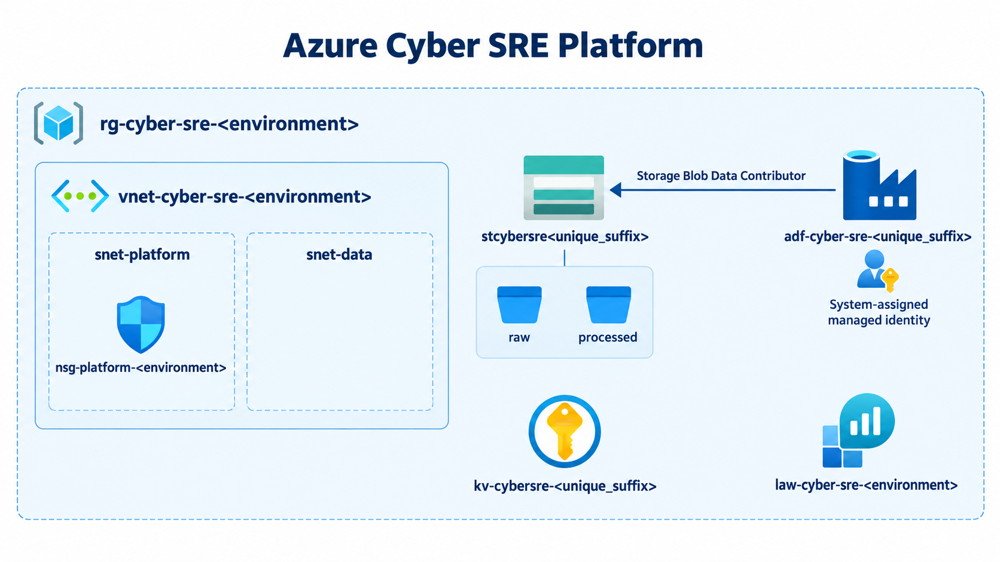

# Azure Cyber SRE Platform

Infrastructure-as-code foundation for a small Azure cyber-security and site-reliability engineering (SRE) platform. The Terraform configuration provisions a network boundary, a Data Lake Storage Gen2 landing zone, Azure Data Factory, Key Vault, and Log Analytics. Supporting operational material includes a PowerShell health check, Kusto query workspace, alerting guidance, and incident documentation.

> This repository is a foundation, not a finished security monitoring product. It does not currently deploy Data Factory pipelines, Log Analytics alert rules, diagnostic settings, private endpoints, or data ingestion connectors.

## Architecture



```text
Resource group: rg-cyber-sre-<environment>
│
├── Virtual network: vnet-cyber-sre-<environment>
│   ├── snet-platform  ── NSG: nsg-platform-<environment>
│   └── snet-data
│
├── ADLS Gen2 account: stcybersre<unique_suffix>
│   ├── raw filesystem
│   └── processed filesystem
│
├── Azure Data Factory: adf-cyber-sre-<unique_suffix>
│   └── system-assigned managed identity
│       └── Storage Blob Data Contributor on the storage account
│
├── Key Vault: kv-cybersre-<unique_suffix>
└── Log Analytics workspace: law-cyber-sre-<environment>
```

For the resource-level implementation, see [terraform/main.tf](terraform/main.tf). Deployment, security, monitoring, and operational procedures are linked below.

## Repository layout

| Path | Purpose |
| --- | --- |
| `terraform/` | Azure resource definitions, variables, state-backend declaration, and provider lock file. |
| `.github/workflows/ci.yml` | GitHub Actions validation, plan, and production apply workflow. |
| `azure-pipelines.yml` | Equivalent Azure DevOps pipeline. Use one CI/CD system as the deployment authority. |
| `powershell/Test-PlatformHealth.ps1` | Authenticated health check for the resource group, Data Factory, and Log Analytics workspace. |
| `monitoring/` | KQL query workspace and alert design guidance. |
| `incident/` | Operational runbook and example post-incident review. |
| `docs/` | Deployment, security, and troubleshooting documentation. |
| `security-events.json` | Small example security-event payload; it is not automatically ingested. |

## Prerequisites

- An Azure subscription in which you can create resources and assign roles.
- [Terraform](https://developer.hashicorp.com/terraform/install), using the version compatible with the committed provider lock file.
- Azure CLI (`az login`) or a service principal / workload identity for non-interactive use.
- PowerShell 7+ and the Az PowerShell modules to run the health check.
- An Azure Storage account and container for remote Terraform state if you use the configured `azurerm` backend.

## Quick start

1. Create a local variable file outside source control. Do not modify or reuse the committed example values for production.

   ```hcl
   subscription_id         = "<subscription-id>"
   location                = "uksouth"
   environment             = "dev"
   unique_suffix           = "<globally-unique-lowercase-suffix>"
   address_prefixes        = ["10.20.0.0/16"]
   subnet_address_prefixes = ["10.20.1.0/24", "10.20.2.0/24"]
   ```

2. Authenticate and initialise Terraform. The backend is declared but its storage settings are intentionally supplied at init time.

   ```bash
   az login
   cd terraform
   terraform init \
     -backend-config="resource_group_name=<state-resource-group>" \
     -backend-config="storage_account_name=<state-storage-account>" \
     -backend-config="container_name=<state-container>" \
     -backend-config="key=cyber-sre.dev.tfstate"
   ```

3. Validate and review the proposed change before applying it.

   ```bash
   terraform fmt -check -recursive
   terraform validate
   terraform plan -var-file="../env/dev.tfvars" -out=tfplan
   terraform apply tfplan
   ```

See [Deployment guide](docs/deployment.md) for state, identity, naming, and CI/CD details.

## Operations

Run a basic deployed-resource health check after authenticating to Azure:

```powershell
Connect-AzAccount
./powershell/Test-PlatformHealth.ps1 -ResourceGroupName "rg-cyber-sre-dev"
```

The script exits with code `0` only when Azure authentication, the named resource group, at least one Data Factory, and at least one Log Analytics workspace are found. It does not validate data-plane access, Data Factory pipeline runs, or query results.

- [Monitoring and alerting](monitoring/alerts.md)
- [Incident runbook](incident/runbook.md)
- [Troubleshooting guide](docs/troubleshooting.md)
- [Security posture and hardening](docs/security.md)
- [Example postmortem](incident/postmortem.md)

## CI/CD

Both GitHub Actions and Azure DevOps definitions validate formatting, initialise Terraform, validate the configuration, create a plan, and apply it after production-environment approval. Before enabling either pipeline, configure its Azure identity and remote-state backend, then choose one pipeline as the sole apply path to prevent competing state operations.

The current workflows use unrestricted Terraform/provider versions and do not pass backend configuration. Treat them as templates that require environment-specific hardening before production use. Details are in the [deployment guide](docs/deployment.md).

## Security notes

The current baseline enforces TLS 1.2 on storage, enables hierarchical namespaces, uses a system-assigned managed identity for Data Factory storage access, and enables Key Vault RBAC authorization. Several production controls remain to be implemented: least-privilege Key Vault role assignments, network restrictions/private endpoints, diagnostic settings, customer-managed keys where required, storage public-access restrictions, and alert rules.

Never commit secrets, state files, backend configuration, generated plans, or environment-specific variable files. The repository currently contains a tracked `terraform.tfvars` and `tfplan`; replace them with safely managed inputs/artifacts before treating the repository as production-ready.

## Contributing

Keep infrastructure changes small and reviewable. Run the following from `terraform/` before opening a pull request:

```bash
terraform fmt -check -recursive
terraform validate
terraform plan
```

Update the associated operational documentation when a resource, access path, alert, or response procedure changes. Do not include credentials, tenant data, subscription IDs, or live operational telemetry in commits.
